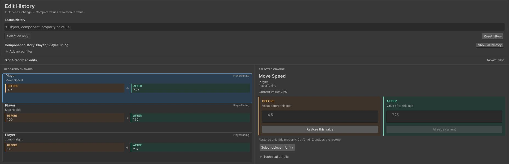
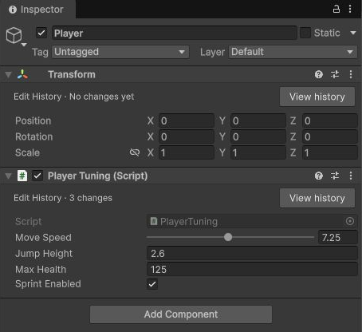

# Edit History

### Find an earlier Inspector value. Restore the field you need.

** In development · Unity 6000.3.9f1**

Edit History records serialized Inspector changes in Edit Mode so you can search a field's history, compare its values, and restore a supported value through Unity's Undo/Redo workflow.

This is the public **showcase and documentation** repository. The paid implementation, installer, and package downloads are not hosted here. The planned storefront is the **Unity Asset Store**; a release date and purchase link have not been announced.

## What it does

- Records serialized property modifications reported by Unity in Edit Mode.
- Searches recorded objects, components, field paths, and values.
- Filters by selection, component, or exact serialized property path.
- Compares before/after values with the current field.
- Restores supported component fields through Unity's Undo/Redo workflow.

Restore currently covers component Boolean, integer, float/double, string, ordinary numeric enum fields, and individual Transform local position/scale axes. Read [compatibility and current limitations](docs/Compatibility.md) before evaluating the pre-release.

## From an edit to a restored value

1. Change a supported serialized field in Edit Mode.
2. Open **Tools > Edit History > Search History**, or the component's **View history** action.
3. Choose a recorded change and compare **Before**, **After**, and **Current value**.
4. Click **Restore this value** under the value you need. Undo reverses the restoration.

## Documentation

- [Start here](docs/README.md)
- [Installation and first restore](docs/QuickStart.md)
- [User guide](docs/UserGuide.md)
- [Compatibility](docs/Compatibility.md)
- [Data and privacy](docs/DataAndPrivacy.md)
- [Troubleshooting](docs/Troubleshooting.md)
- [Support](docs/Support.md)
- [Changelog](docs/CHANGELOG.md)

## Reports and requests

Use [Issues > New issue](https://github.com/yqwz1/Edit-History-Showcase/issues/new/choose) for sanitized bug reports and requests. Keep project history, proprietary source, purchase details, and the paid package out of public attachments. See [security reporting](SECURITY.md) for sensitive matters.

Public access allows reading, downloading, and forking these documentation files. It does not provide the paid implementation or grant a tool license. The planned store distribution uses the [Unity Asset Store EULA](https://unity.com/legal/as-terms). See the [rights notice](LICENSE.md).
